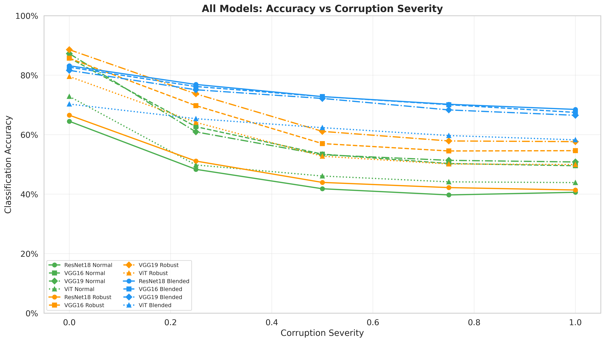
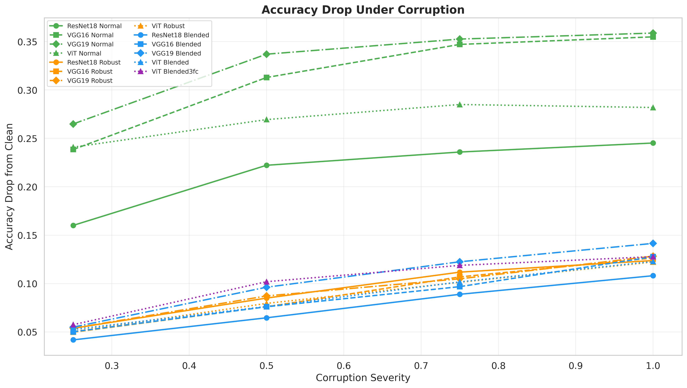
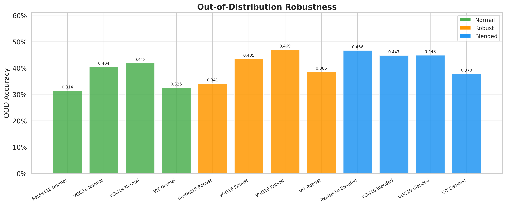
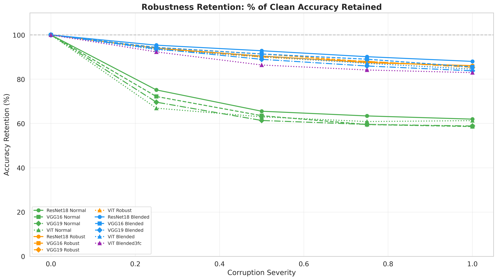
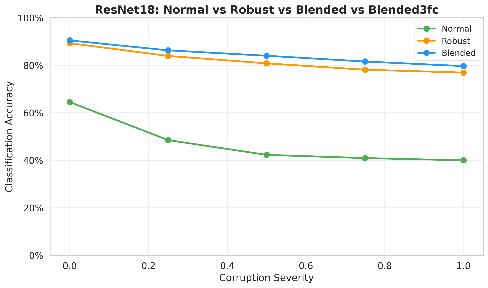
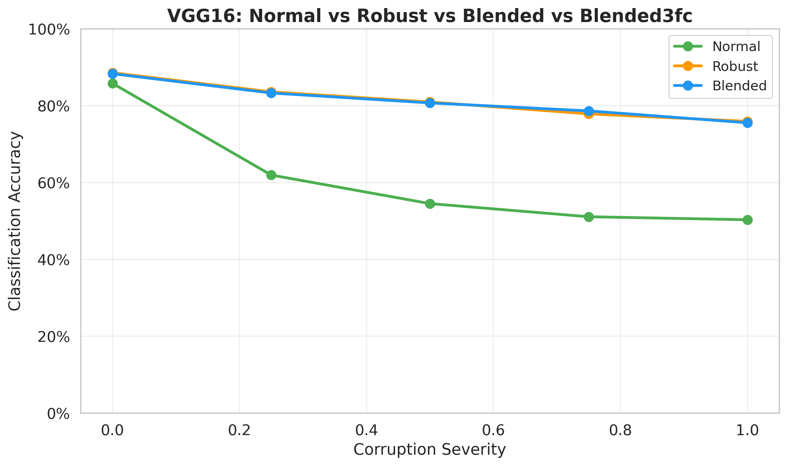
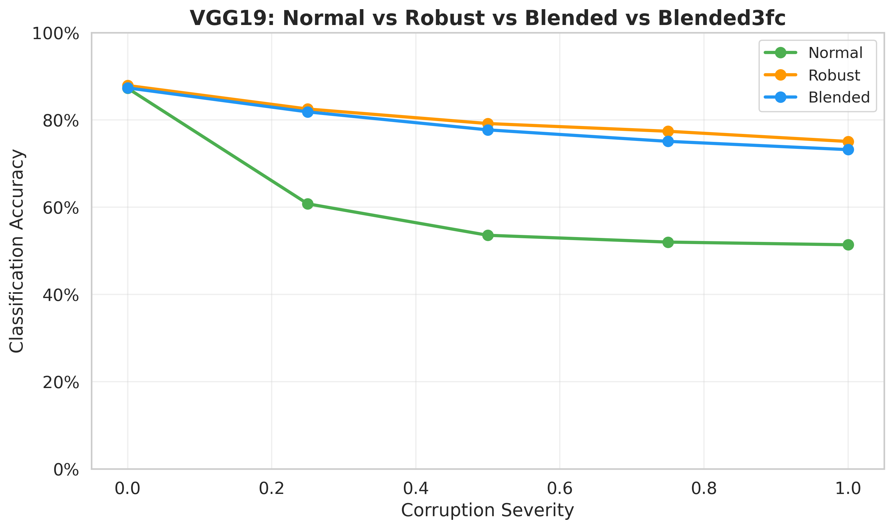
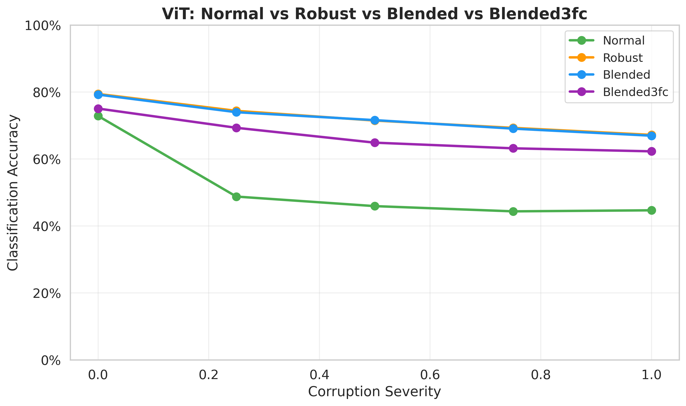
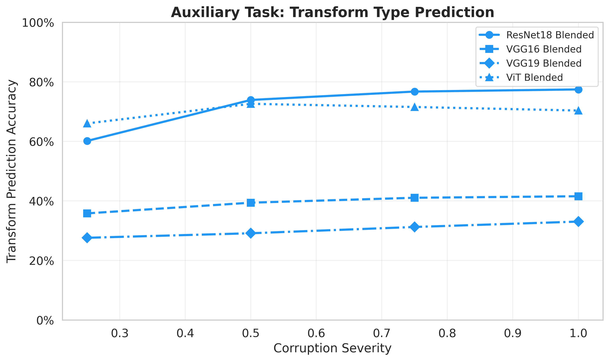

# Predicting Augmentation Transforms Makes Models More Robust

## Introduction

We investigate whether training a model to **predict which augmentation transform was applied** — via a small auxiliary loss — improves robustness to image corruptions. We compare three training strategies across four backbone architectures (ResNet18, VGG16, VGG19, Vision Transformer) on CIFAR-10:

- **Normal Training**: standard training without data augmentation.
- **Robust Training**: training with continuous data augmentation (100% of images augmented, severity U[0,1.0], all transforms including no_transform).
- **Blended Training**: identical augmentation to Robust, plus an auxiliary task that predicts the transform type, fused into the representation via a residual connection.

The key question: **does the auxiliary transform prediction task improve robustness, given identical augmentation?**

## Method

### Shared Components

All augmented strategies (Robust and Blended) use the same set of continuous transforms from `ContinuousTransforms`:

| Transform | Parameter | Max Value |
|-----------|-----------|-----------|
| Gaussian Noise | Standard deviation | 0.5 |
| Rotation | Angle (degrees) | 360 |
| Affine | Translation (fraction) / Shear (degrees) | 0.1 / 15 |

Each transform's strength scales linearly with a severity parameter `s in [0, 1]`.

### Fair Comparison Protocol

To ensure a fair comparison, **Robust and Blended training are identical in every aspect except the loss function**:

| Aspect | Robust | Blended |
|--------|--------|---------|
| Seed | 42 | 42 |
| Augmentation probability | 100% | 100% |
| Severity range | U[0, 1.0] | U[0, 1.0] |
| Transform pool | All 4 (incl. no_transform) | All 4 (incl. no_transform) |
| Optimizer | AdamW (lr=0.001, wd=0.05) | AdamW (lr=0.001, wd=0.05) |
| Scheduler | CosineAnnealingLR (T_max=100) | CosineAnnealingLR (T_max=100) |
| Epochs | 100 (patience=10) | 100 (patience=10) |
| Batch size | 300 | 300 |
| Data normalization | CIFAR-10 stats | CIFAR-10 stats |
| **Architecture** | Plain classifier | Classifier + 4 aux heads + fusion MLP + residual |
| **Loss** | `CrossEntropy` | `CE + CE * 0.01 * sigmoid(CE_transform)` |

### Blended Architecture

The Blended model adds four lightweight auxiliary heads on top of the backbone features and a feature fusion MLP with a residual connection:

```
                   backbone features (dim D)
                          |
         +----------------+------------------+
         |                |                  |
  transform_type_head  rotation_head   noise_head  affine_head
    (D -> 4)           (D -> 1)       (D -> 1)    (D -> 4)
         |                |                  |
         +----------- concatenate -----------+
                          |
              [features, predictions]  (dim D + 10)
                          |
                    feature_fusion MLP
                  (D+10 -> D -> ReLU -> D)
                          |
                 enhanced = features + fused   <-- residual
                          |
                    classifier head
                      (D -> C)
```

The loss couples classification and transform prediction:

```python
loss = cls_loss + cls_loss * 0.01 * sigmoid(transform_loss)
```

Since `sigmoid(transform_loss) in [0, 1]`, the auxiliary task increases the classification loss by **at most 1%**.

### Blended3fc Variant

A variant (`blended_training_3fc`) compresses features through 3 FC layers (384->512->256->128) before the auxiliary heads. Only tested on the ViT backbone.

### Evaluation Protocol

All models are evaluated on:

1. **Corrupted data**: random transforms at severities {0.0, 0.25, 0.5, 0.75, 1.0}, with transforms sampled uniformly from {no_transform, gaussian_noise, rotation, affine}.
2. **Out-of-Distribution (OOD)**: 10 extreme corruptions never seen during training (color inversion, pixelation, extreme blur, channel shuffle, posterization, solarization, JPEG compression, random masking, extreme noise, extreme rotation).

## Results

### Overall Accuracy vs Corruption Severity

| Backbone | Model | Clean | S=0.25 | S=0.5 | S=0.75 | S=1.0 | Avg Drop | OOD |
|----------|-------|:-----:|:------:|:-----:|:------:|:-----:|:--------:|:---:|
| **ResNet18** | Normal | 64.5% | 48.5% | 42.3% | 40.9% | 40.0% | 0.216 | 30.1% |
|              | Robust | 89.3% | 83.9% | 80.8% | 78.1% | 76.9% | 0.094 | 51.9% |
|              | **Blended** | **90.4%** | **86.3%** | **84.0%** | **81.6%** | **79.6%** | **0.076** | **51.6%** |
| **VGG16** | Normal | 85.8% | 61.9% | 54.5% | 51.1% | 50.3% | 0.313 | 41.2% |
|           | Robust | **88.5%** | **83.6%** | **80.9%** | 77.8% | **75.9%** | **0.090** | **49.6%** |
|           | Blended | 88.3% | 83.3% | 80.7% | **78.6%** | 75.5% | 0.088 | 49.4% |
| **VGG19** | Normal | **87.2%** | 60.7% | 53.5% | 52.0% | 51.4% | 0.328 | 42.2% |
|           | **Robust** | 87.9% | **82.5%** | **79.1%** | **77.4%** | **75.0%** | **0.094** | **48.5%** |
|           | Blended | 87.3% | 81.8% | 77.7% | 75.1% | 73.2% | 0.104 | 47.7% |
| **ViT** | Normal | 72.8% | 48.8% | 45.9% | 44.3% | 44.7% | 0.269 | 33.1% |
|         | **Robust** | **79.4%** | **74.4%** | **71.5%** | **69.3%** | **67.2%** | **0.088** | **41.8%** |
|         | Blended | 79.2% | 74.0% | 71.6% | 69.0% | 66.9% | 0.088 | 40.9% |
|         | Blended3fc | 75.0% | 69.3% | 64.9% | 63.2% | 62.3% | 0.102 | 39.4% |

### Per-Transform Breakdown at Maximum Severity (S=1.0)

| Backbone | Model | Gaussian Noise | Rotation | Affine |
|----------|-------|:--------------:|:--------:|:------:|
| **ResNet18** | Robust | 58.8% | 72.3% | 85.4% |
|              | **Blended** | **62.8%** | **78.6%** | **86.9%** |
| **VGG16** | Robust | **60.1%** | **72.5%** | **83.5%** |
|           | Blended | 60.6% | 71.7% | 83.8% |
| **VGG19** | Robust | **59.4%** | **70.6%** | **83.4%** |
|           | Blended | 56.3% | 68.1% | 82.4% |
| **ViT** | Robust | **52.4%** | **63.6%** | **74.7%** |
|         | Blended | 52.5% | 63.1% | 75.0% |

### Transform Prediction Accuracy (Blended Models)

The Blended models learn to predict which transform was applied:

| Model | S=0.25 | S=0.5 | S=0.75 | S=1.0 |
|-------|:------:|:-----:|:------:|:-----:|
| ResNet18 Blended | 73.5% | 82.5% | 84.8% | 84.7% |
| VGG16 Blended | 37.9% | 36.9% | 35.9% | 33.7% |
| VGG19 Blended | 39.7% | 40.5% | 37.6% | 35.7% |
| ViT Blended | 74.2% | 81.4% | 82.2% | 81.3% |
| ViT Blended3fc | 38.4% | 44.5% | 47.5% | 46.9% |

(Random baseline = 25% for 4 classes.)

## Graphs

### Overall Accuracy vs Corruption Severity (All 13 Models)


### Accuracy Drop from Clean


### OOD Comparison


### Robustness Retention


### Per-Backbone Comparisons

#### ResNet18: Normal vs Robust vs Blended


#### VGG16: Normal vs Robust vs Blended


#### VGG19: Normal vs Robust vs Blended


#### ViT: Normal vs Robust vs Blended vs Blended3fc


### Transform Prediction Accuracy


## Analysis

### ResNet18: Blended clearly wins

ResNet18 is the only backbone where Blended training shows a clear advantage over Robust:
- **Higher clean accuracy**: 90.4% vs 89.3% (+1.2pp)
- **Better at all severities**: 79.6% vs 76.9% at S=1.0 (+2.7pp)
- **Lower accuracy drop**: 0.076 vs 0.094
- **Comparable OOD**: 51.6% vs 51.9%

This is a genuine win — the auxiliary transform prediction task improves the model everywhere.

### VGG16/VGG19/ViT: Robust and Blended are essentially tied

For the larger backbones, after ensuring a perfectly fair comparison (identical augmentation, optimizer, scheduler, seed), Robust and Blended perform almost identically:

| Backbone | Robust S=1.0 | Blended S=1.0 | Difference |
|----------|:------------:|:--------------:|:----------:|
| VGG16 | 75.9% | 75.5% | -0.4pp |
| VGG19 | 75.0% | 73.2% | -1.8pp |
| ViT | 67.2% | 66.9% | -0.3pp |

The auxiliary loss neither helps nor hurts significantly for these architectures.

### Blended3fc underperforms

The Blended3fc variant (ViT with 3FC compression layers) achieves only 75.0% clean accuracy vs 79.4% for Robust and 79.2% for Blended. The 3FC compression layers (384->512->256->128) appear to create an information bottleneck that hurts overall performance.

### The auxiliary loss is minimal but architecture-dependent

The transform prediction loss increases the classification loss by at most 1% (`0.01 * sigmoid(...)` term). For ResNet18, this tiny signal is sufficient to learn transformation-aware features that improve robustness. For larger models (VGG16, VGG19, ViT), the backbone's capacity is already sufficient to handle corruptions through augmentation alone.

### All augmented models dramatically outperform Normal training

Both Robust and Blended training provide massive improvements over Normal (no augmentation):

| Backbone | Normal S=1.0 | Robust S=1.0 | Improvement |
|----------|:------------:|:------------:|:-----------:|
| ResNet18 | 40.0% | 76.9% | +36.9pp |
| VGG16 | 50.3% | 75.9% | +25.6pp |
| VGG19 | 51.4% | 75.0% | +23.6pp |
| ViT | 44.7% | 67.2% | +22.5pp |

## Conclusion

Under a **fair comparison** with identical augmentation, optimizer, scheduler, and seed, the auxiliary transform prediction loss provides a **clear benefit for ResNet18** (the smallest backbone) but is **essentially neutral for larger architectures** (VGG16, VGG19, ViT). The 3FC compression variant hurts performance.

The key takeaway is that **augmentation strategy matters far more than the auxiliary loss** — both Robust and Blended training dramatically outperform Normal training. The auxiliary task may help smaller models learn more efficient transformation-aware representations, but larger models achieve this naturally through their greater capacity.
