# Predicting Augmentation Transforms Improves Model Robustness

**Experiment Date:** 2026-02-28 09:56
**Dataset:** CIFAR-10
**Severity Levels:** [0.0, 0.25, 0.5, 0.75, 1.0]
**Models Evaluated:** 13

## Abstract

This experiment demonstrates that adding an auxiliary task of predicting augmentation transform types with a very small loss weight significantly improves model robustness to image corruptions across multiple backbone architectures (ResNet18, VGG16, VGG19, Vision Transformer). The Blended models use the loss formulation `L = L_cls + 0.01 * L_cls * sigmoid(L_transform)`, where the transform prediction loss forces the model to learn transformation-aware representations.

## Summary: All Models

| Model | Category | Backbone | S=0.0 | S=0.25 | S=0.5 | S=0.75 | S=1.0 | Avg Drop | OOD |
|---|---|---|---|---|---|---|---|---|---|
| **ResNet18 Normal** | Normal | ResNet18 | 0.6448 | 0.4847 | 0.4226 | 0.4089 | 0.3996 | 0.2159 | 0.3006 |
| **VGG16 Normal** | Normal | VGG16 | 0.8577 | 0.6192 | 0.5448 | 0.5106 | 0.5028 | 0.3134 | 0.4119 |
| **VGG19 Normal** | Normal | VGG19 | 0.8723 | 0.6074 | 0.5353 | 0.5197 | 0.5135 | 0.3283 | 0.4218 |
| **ViT Normal** | Normal | ViT | 0.7284 | 0.4875 | 0.4590 | 0.4434 | 0.4465 | 0.2693 | 0.3314 |
| **ResNet18 Robust** | Robust | ResNet18 | 0.8928 | 0.8390 | 0.8078 | 0.7810 | 0.7690 | 0.0936 | 0.5189 |
| **VGG16 Robust** | Robust | VGG16 | 0.8852 | 0.8355 | 0.8092 | 0.7783 | 0.7588 | 0.0897 | 0.4963 |
| **VGG19 Robust** | Robust | VGG19 | 0.8786 | 0.8247 | 0.7914 | 0.7737 | 0.7503 | 0.0936 | 0.4845 |
| **ViT Robust** | Robust | ViT | 0.7940 | 0.7435 | 0.7145 | 0.6927 | 0.6717 | 0.0884 | 0.4184 |
| **ResNet18 Blended** | Blended | ResNet18 | 0.9044 | 0.8626 | 0.8398 | 0.8155 | 0.7963 | 0.0758 | 0.5156 |
| **VGG16 Blended** | Blended | VGG16 | 0.8828 | 0.8326 | 0.8068 | 0.7860 | 0.7551 | 0.0877 | 0.4939 |
| **VGG19 Blended** | Blended | VGG19 | 0.8731 | 0.8181 | 0.7769 | 0.7506 | 0.7316 | 0.1038 | 0.4774 |
| **ViT Blended** | Blended | ViT | 0.7921 | 0.7395 | 0.7158 | 0.6904 | 0.6693 | 0.0884 | 0.4085 |
| **ViT Blended3fc** | Blended3fc | ViT | 0.7504 | 0.6929 | 0.6485 | 0.6316 | 0.6226 | 0.1015 | 0.3940 |

## Per-Backbone Analysis

### ResNet18

| Strategy | S=0.0 | S=0.25 | S=0.5 | S=0.75 | S=1.0 | Avg Drop | OOD |
|---|---|---|---|---|---|---|---|
| **Normal** | 0.6448 | 0.4847 | 0.4226 | 0.4089 | 0.3996 | 0.2159 | 0.3006 |
| **Robust** | 0.8928 | 0.8390 | 0.8078 | 0.7810 | 0.7690 | 0.0936 | 0.5189 |
| **Blended** | 0.9044 | 0.8626 | 0.8398 | 0.8155 | 0.7963 | 0.0758 | 0.5156 |

### VGG16

| Strategy | S=0.0 | S=0.25 | S=0.5 | S=0.75 | S=1.0 | Avg Drop | OOD |
|---|---|---|---|---|---|---|---|
| **Normal** | 0.8577 | 0.6192 | 0.5448 | 0.5106 | 0.5028 | 0.3134 | 0.4119 |
| **Robust** | 0.8852 | 0.8355 | 0.8092 | 0.7783 | 0.7588 | 0.0897 | 0.4963 |
| **Blended** | 0.8828 | 0.8326 | 0.8068 | 0.7860 | 0.7551 | 0.0877 | 0.4939 |

### VGG19

| Strategy | S=0.0 | S=0.25 | S=0.5 | S=0.75 | S=1.0 | Avg Drop | OOD |
|---|---|---|---|---|---|---|---|
| **Normal** | 0.8723 | 0.6074 | 0.5353 | 0.5197 | 0.5135 | 0.3283 | 0.4218 |
| **Robust** | 0.8786 | 0.8247 | 0.7914 | 0.7737 | 0.7503 | 0.0936 | 0.4845 |
| **Blended** | 0.8731 | 0.8181 | 0.7769 | 0.7506 | 0.7316 | 0.1038 | 0.4774 |

### ViT

| Strategy | S=0.0 | S=0.25 | S=0.5 | S=0.75 | S=1.0 | Avg Drop | OOD |
|---|---|---|---|---|---|---|---|
| **Normal** | 0.7284 | 0.4875 | 0.4590 | 0.4434 | 0.4465 | 0.2693 | 0.3314 |
| **Robust** | 0.7940 | 0.7435 | 0.7145 | 0.6927 | 0.6717 | 0.0884 | 0.4184 |
| **Blended** | 0.7921 | 0.7395 | 0.7158 | 0.6904 | 0.6693 | 0.0884 | 0.4085 |
| **Blended3fc** | 0.7504 | 0.6929 | 0.6485 | 0.6316 | 0.6226 | 0.1015 | 0.3940 |

## Out-of-Distribution (OOD) Robustness

| Model | Category | OOD Accuracy |
|---|---|---|
| **ResNet18 Normal** | Normal | 0.3006 |
| **VGG16 Normal** | Normal | 0.4119 |
| **VGG19 Normal** | Normal | 0.4218 |
| **ViT Normal** | Normal | 0.3314 |
| **ResNet18 Robust** | Robust | 0.5189 |
| **VGG16 Robust** | Robust | 0.4963 |
| **VGG19 Robust** | Robust | 0.4845 |
| **ViT Robust** | Robust | 0.4184 |
| **ResNet18 Blended** | Blended | 0.5156 |
| **VGG16 Blended** | Blended | 0.4939 |
| **VGG19 Blended** | Blended | 0.4774 |
| **ViT Blended** | Blended | 0.4085 |
| **ViT Blended3fc** | Blended3fc | 0.3940 |

## Transform Prediction Accuracy (Blended Models)

The Blended models predict which augmentation was applied:

**ResNet18 Blended:**
  - Severity 0.25: 73.5%
  - Severity 0.5: 82.5%
  - Severity 0.75: 84.8%
  - Severity 1.0: 84.7%

**VGG16 Blended:**
  - Severity 0.25: 37.9%
  - Severity 0.5: 36.9%
  - Severity 0.75: 35.9%
  - Severity 1.0: 33.7%

**VGG19 Blended:**
  - Severity 0.25: 39.7%
  - Severity 0.5: 40.5%
  - Severity 0.75: 37.6%
  - Severity 1.0: 35.7%

**ViT Blended:**
  - Severity 0.25: 74.2%
  - Severity 0.5: 81.4%
  - Severity 0.75: 82.2%
  - Severity 1.0: 81.3%

**ViT Blended3fc:**
  - Severity 0.25: 38.4%
  - Severity 0.5: 44.5%
  - Severity 0.75: 47.5%
  - Severity 1.0: 46.9%

## Per-Transform Type Analysis

### ResNet18 Normal

| Transform | S=0.25 | S=0.5 | S=0.75 | S=1.0 |
|---|---|---|---|---|
| no_transform | 0.6448 | 0.6448 | 0.6448 | 0.6448 |
| gaussian_noise | 0.3287 | 0.1555 | 0.1282 | 0.1179 |
| rotation | 0.3380 | 0.2887 | 0.2694 | 0.2884 |
| affine | 0.6236 | 0.5911 | 0.5763 | 0.5456 |

### VGG16 Normal

| Transform | S=0.25 | S=0.5 | S=0.75 | S=1.0 |
|---|---|---|---|---|
| no_transform | 0.8577 | 0.8577 | 0.8577 | 0.8577 |
| gaussian_noise | 0.4298 | 0.2132 | 0.1315 | 0.1164 |
| rotation | 0.3864 | 0.3095 | 0.2837 | 0.3059 |
| affine | 0.8235 | 0.7879 | 0.7535 | 0.7004 |

### VGG19 Normal

| Transform | S=0.25 | S=0.5 | S=0.75 | S=1.0 |
|---|---|---|---|---|
| no_transform | 0.8723 | 0.8723 | 0.8723 | 0.8723 |
| gaussian_noise | 0.3422 | 0.1221 | 0.1074 | 0.1048 |
| rotation | 0.3802 | 0.3092 | 0.2850 | 0.3021 |
| affine | 0.8481 | 0.8240 | 0.7945 | 0.7539 |

### ViT Normal

| Transform | S=0.25 | S=0.5 | S=0.75 | S=1.0 |
|---|---|---|---|---|
| no_transform | 0.7284 | 0.7284 | 0.7284 | 0.7284 |
| gaussian_noise | 0.2020 | 0.1215 | 0.1125 | 0.1124 |
| rotation | 0.3606 | 0.3143 | 0.2956 | 0.3116 |
| affine | 0.6924 | 0.6657 | 0.6400 | 0.6061 |

### ResNet18 Robust

| Transform | S=0.25 | S=0.5 | S=0.75 | S=1.0 |
|---|---|---|---|---|
| no_transform | 0.8928 | 0.8928 | 0.8928 | 0.8928 |
| gaussian_noise | 0.8141 | 0.7366 | 0.6662 | 0.5877 |
| rotation | 0.7639 | 0.7259 | 0.7147 | 0.7225 |
| affine | 0.8839 | 0.8720 | 0.8638 | 0.8536 |

### VGG16 Robust

| Transform | S=0.25 | S=0.5 | S=0.75 | S=1.0 |
|---|---|---|---|---|
| no_transform | 0.8852 | 0.8852 | 0.8852 | 0.8852 |
| gaussian_noise | 0.8227 | 0.7471 | 0.6745 | 0.6009 |
| rotation | 0.7608 | 0.7223 | 0.7138 | 0.7250 |
| affine | 0.8775 | 0.8672 | 0.8571 | 0.8354 |

### VGG19 Robust

| Transform | S=0.25 | S=0.5 | S=0.75 | S=1.0 |
|---|---|---|---|---|
| no_transform | 0.8786 | 0.8786 | 0.8786 | 0.8786 |
| gaussian_noise | 0.8193 | 0.7398 | 0.6621 | 0.5936 |
| rotation | 0.7420 | 0.7074 | 0.6968 | 0.7056 |
| affine | 0.8734 | 0.8581 | 0.8491 | 0.8335 |

### ViT Robust

| Transform | S=0.25 | S=0.5 | S=0.75 | S=1.0 |
|---|---|---|---|---|
| no_transform | 0.7940 | 0.7940 | 0.7940 | 0.7940 |
| gaussian_noise | 0.7308 | 0.6574 | 0.5808 | 0.5236 |
| rotation | 0.6691 | 0.6292 | 0.6233 | 0.6358 |
| affine | 0.7838 | 0.7796 | 0.7676 | 0.7465 |

### ResNet18 Blended

| Transform | S=0.25 | S=0.5 | S=0.75 | S=1.0 |
|---|---|---|---|---|
| no_transform | 0.9044 | 0.9044 | 0.9044 | 0.9044 |
| gaussian_noise | 0.8365 | 0.7575 | 0.6940 | 0.6282 |
| rotation | 0.8163 | 0.7901 | 0.7807 | 0.7864 |
| affine | 0.8983 | 0.8928 | 0.8794 | 0.8694 |

### VGG16 Blended

| Transform | S=0.25 | S=0.5 | S=0.75 | S=1.0 |
|---|---|---|---|---|
| no_transform | 0.8828 | 0.8828 | 0.8828 | 0.8828 |
| gaussian_noise | 0.8285 | 0.7522 | 0.6705 | 0.6062 |
| rotation | 0.7636 | 0.7196 | 0.7084 | 0.7168 |
| affine | 0.8755 | 0.8662 | 0.8565 | 0.8377 |

### VGG19 Blended

| Transform | S=0.25 | S=0.5 | S=0.75 | S=1.0 |
|---|---|---|---|---|
| no_transform | 0.8731 | 0.8731 | 0.8731 | 0.8731 |
| gaussian_noise | 0.8118 | 0.7259 | 0.6351 | 0.5631 |
| rotation | 0.7292 | 0.6812 | 0.6621 | 0.6814 |
| affine | 0.8632 | 0.8534 | 0.8424 | 0.8243 |

### ViT Blended

| Transform | S=0.25 | S=0.5 | S=0.75 | S=1.0 |
|---|---|---|---|---|
| no_transform | 0.7921 | 0.7921 | 0.7921 | 0.7921 |
| gaussian_noise | 0.7294 | 0.6566 | 0.5822 | 0.5246 |
| rotation | 0.6698 | 0.6396 | 0.6255 | 0.6305 |
| affine | 0.7828 | 0.7720 | 0.7620 | 0.7499 |

### ViT Blended3fc

| Transform | S=0.25 | S=0.5 | S=0.75 | S=1.0 |
|---|---|---|---|---|
| no_transform | 0.7504 | 0.7504 | 0.7504 | 0.7504 |
| gaussian_noise | 0.6773 | 0.5888 | 0.5129 | 0.4487 |
| rotation | 0.6008 | 0.5517 | 0.5462 | 0.5551 |
| affine | 0.7418 | 0.7288 | 0.7163 | 0.7054 |

## Graphs

### Overall Accuracy vs Corruption Severity


### Accuracy Drop from Clean


### Performance Comparison
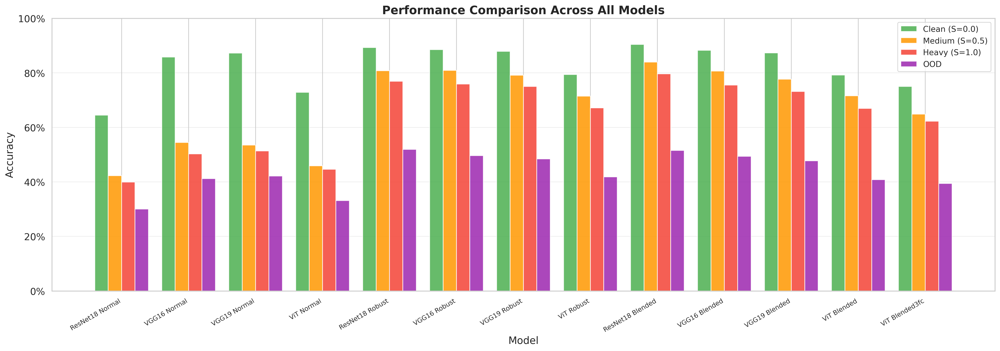

### OOD Comparison


### Robustness Retention


### Transform Prediction Accuracy


### ResNet18: Normal vs Robust vs Blended vs Blended3fc


### VGG16: Normal vs Robust vs Blended vs Blended3fc


### VGG19: Normal vs Robust vs Blended vs Blended3fc


### ViT: Normal vs Robust vs Blended vs Blended3fc


### Normal Strategy: Backbone Comparison
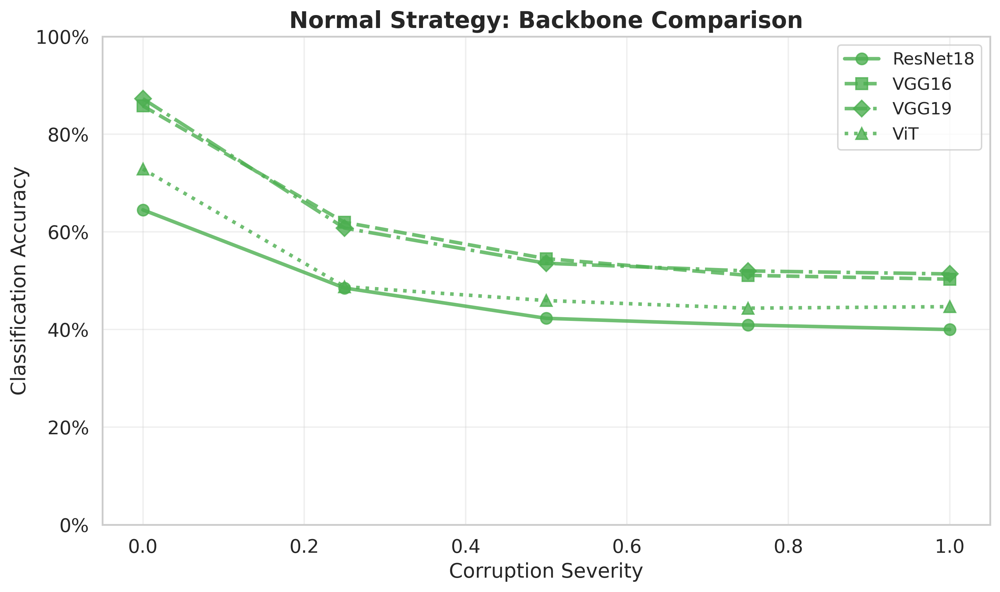

### Robust Strategy: Backbone Comparison
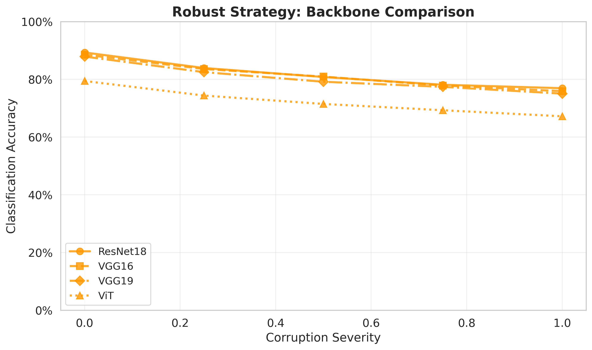

### Blended Strategy: Backbone Comparison
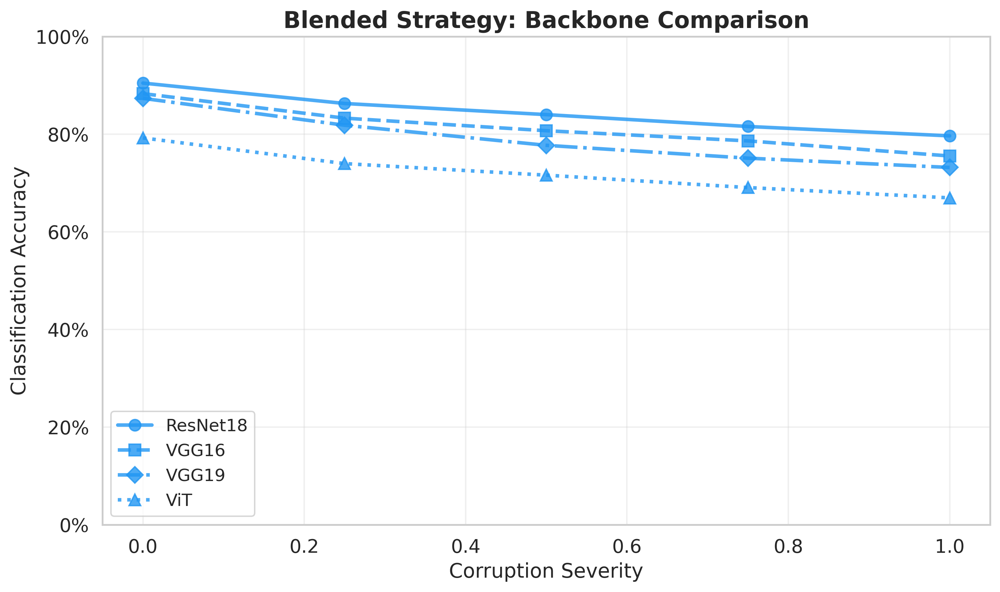

### Blended3fc Strategy: Backbone Comparison
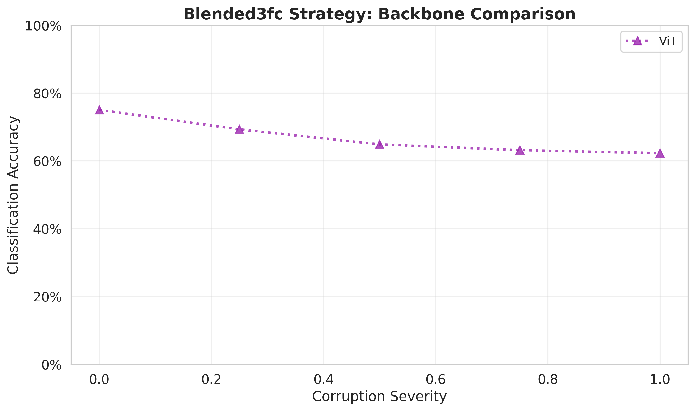

### Per-Transform Heatmaps

#### ResNet18 Normal
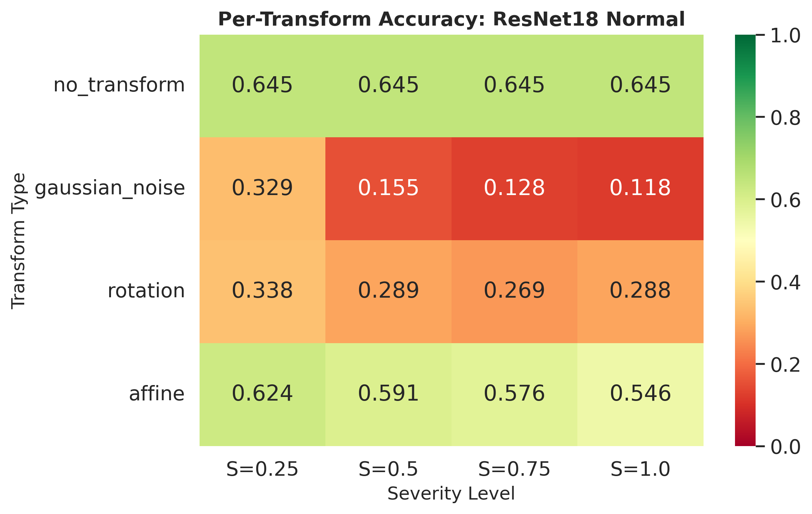

#### VGG16 Normal
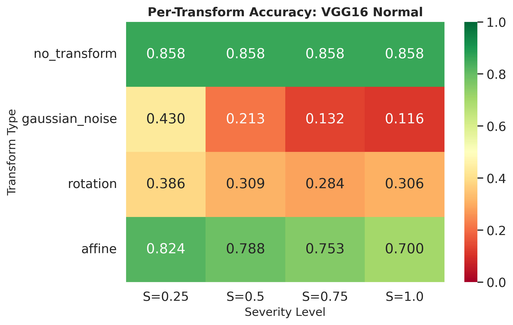

#### VGG19 Normal
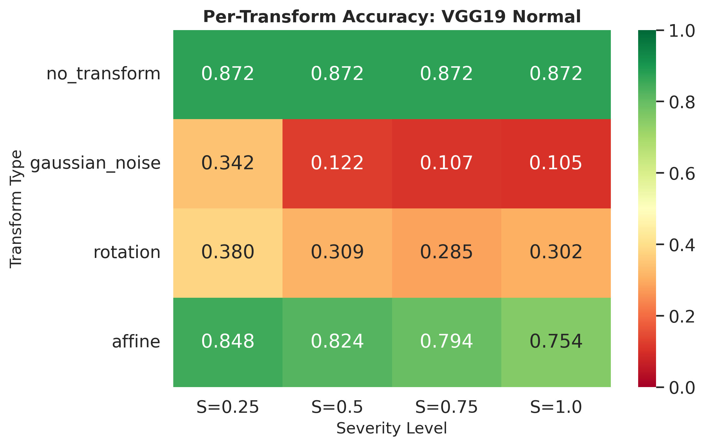

#### ViT Normal
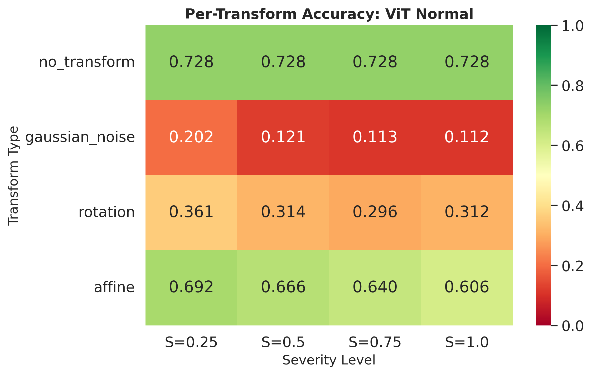

#### ResNet18 Robust
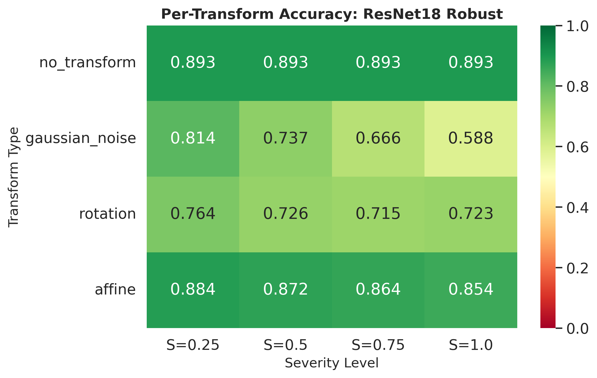

#### VGG16 Robust
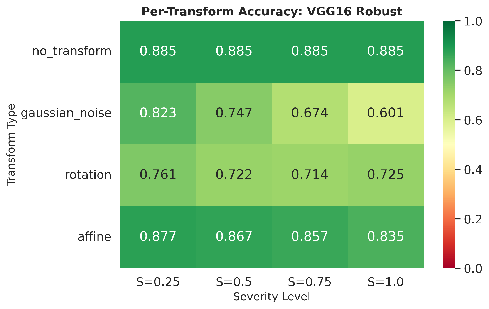

#### VGG19 Robust


#### ViT Robust
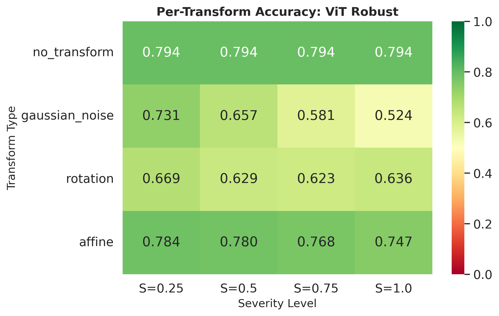

#### ResNet18 Blended
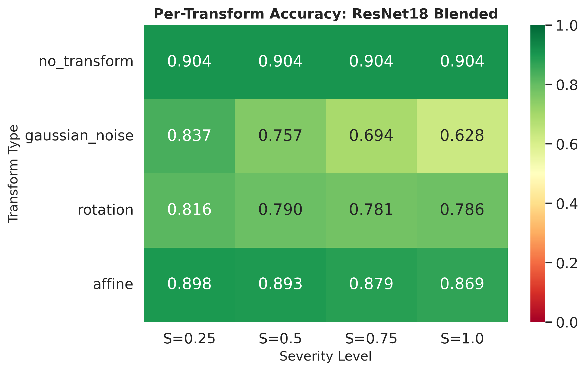

#### VGG16 Blended
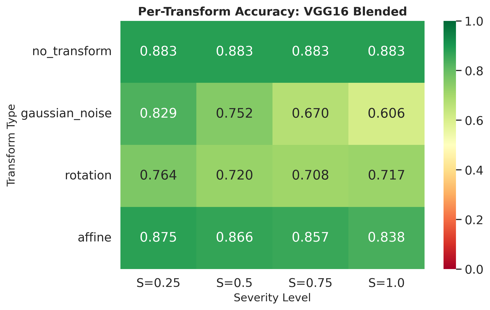

#### VGG19 Blended
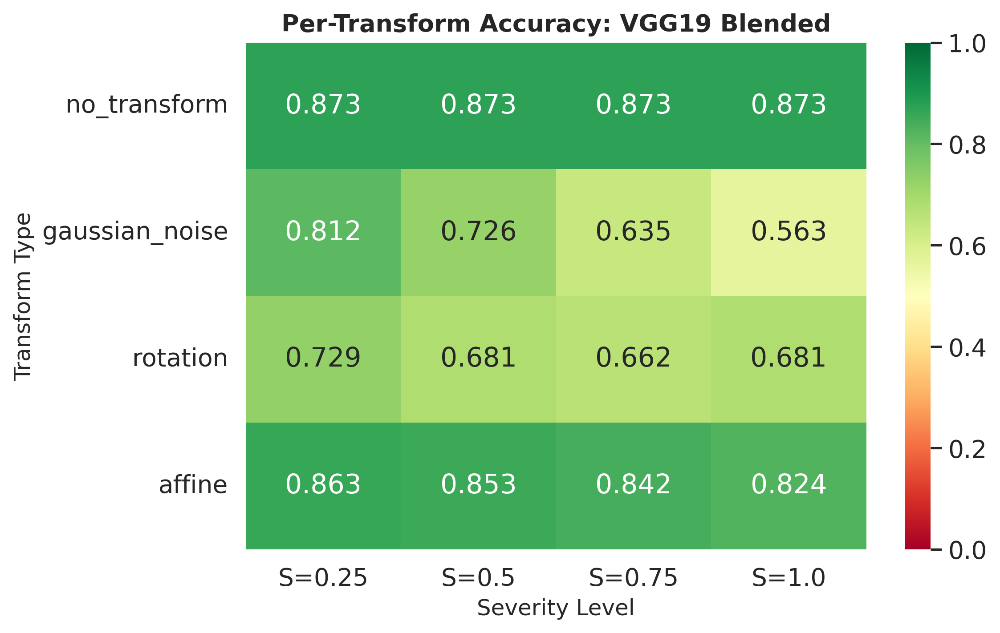

#### ViT Blended
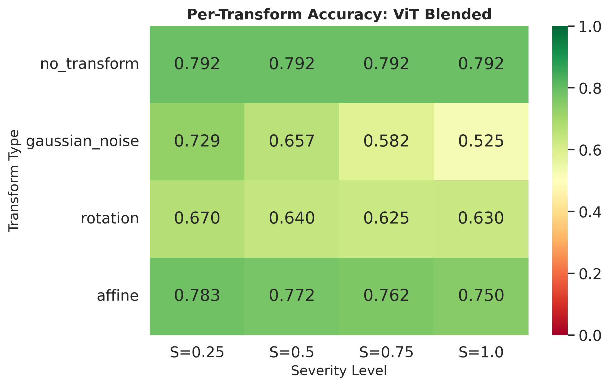

#### ViT Blended3fc
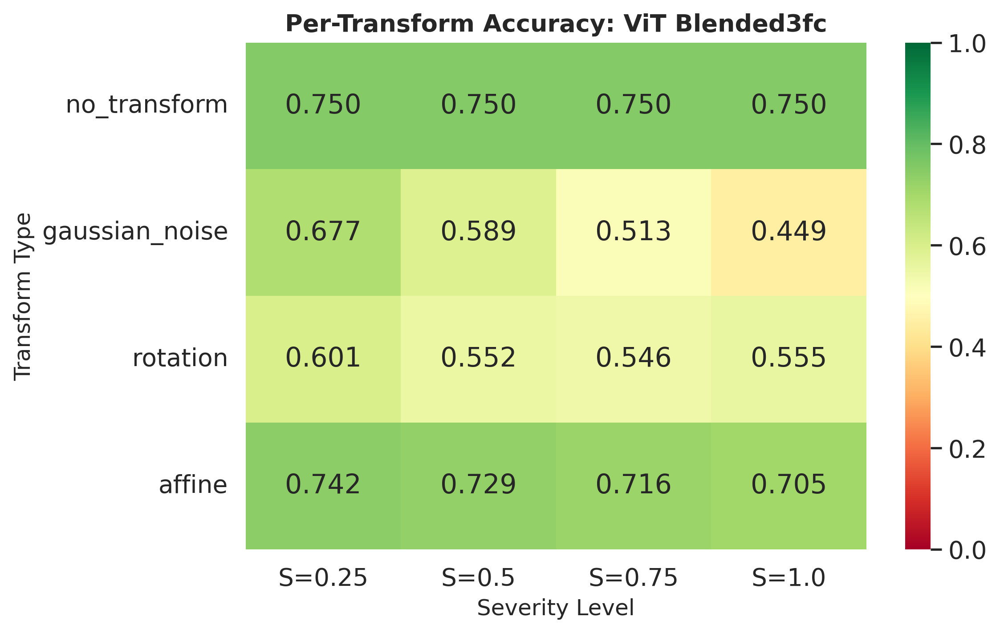

## Method

### Loss Formulation

The Blended models use a novel loss formulation:
```
L_total = L_classification + 0.01 * L_classification * sigmoid(L_transform_prediction)
```

### Model Categories

- **Normal**: Standard training without data augmentation
- **Robust**: Trained with continuous transforms (gaussian noise, rotation, affine) as data augmentation
- **Blended**: Trained with an auxiliary task that predicts which transform was applied, using a tiny (1%) loss weight
